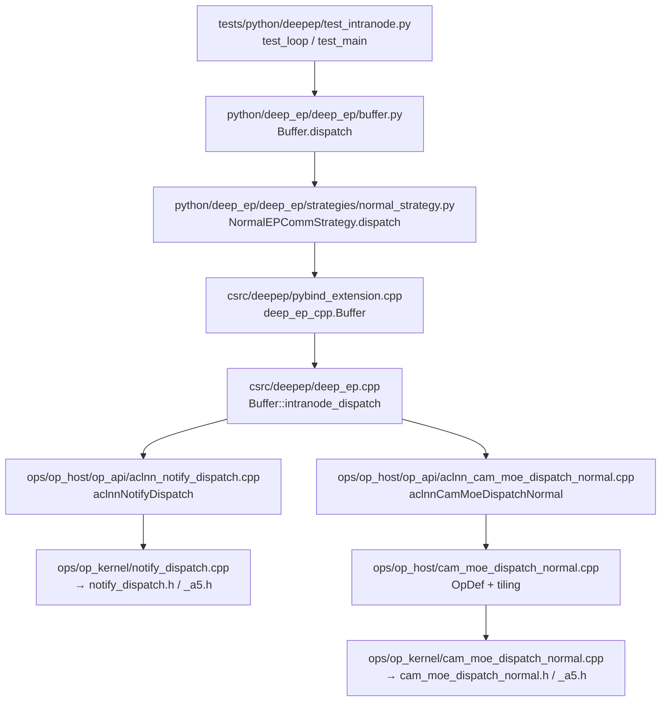

# DeepEP Normal 模式单链路调用图

范围：`normal` 模式、单机（intranode）`dispatch`，bf16 默认路径。
行号基于当前工作区；`[A2] [A3] [A5]` 标注卡型分叉点。

---

## 1. 总览



`[A2]` 构建时把 `ops/` 换成 `ops2/`，函数名与调用点完全不变；
`[A5]` 在 `ops/` 内按 tiling key 选 `_a5` kernel。

---

## 2. 逐步调用表

| # | 文件 | 符号 / 位置 | 接收 | 交给下一层 |
|---|---|---|---|---|
| 1 | `tests/python/deepep/test_intranode.py` | `test_loop` L572 | `local_rank, num_local_ranks, args` | `rank, num_ranks, group` |
| 2 | 同上 | `Buffer(...)` L576-578 | `group, 2e9, 0, low_latency_mode=False, num_qps_per_rank=1` | `buffer` 实例 |
| 3 | 同上 | `test_main` L585 调用 | 7 个入参 | — |
| 4 | 同上 | `buffer.get_dispatch_layout(...)` L244 | `topk_idx, num_experts` | 3 张布局表 |
| 5 | 同上 | `buffer.dispatch(**dispatch_args)` L539 | 7 个键 + quant kwargs | `recv_x, handle` |
| 6 | `python/deep_ep/deep_ep/buffer.py` | `Buffer.dispatch` L297 | 同上 | 补 `config`、算 `quant_mode` |
| 7 | `python/deep_ep/deep_ep/utils.py` | `_resolve_quant_mode` L42-80 | 3 个 bool + SoC 码 | `quant_mode` 字符串 |
| 8 | `python/deep_ep/deep_ep/strategies/normal_strategy.py` | `dispatch` L175 | 全部张量 | `runtime.intranode_dispatch(...)` |
| 9 | `csrc/deepep/pybind_extension.cpp` | `Buffer` 绑定 L17-56 | Python 参数 | C++ 成员函数 |
| 10 | `csrc/deepep/deep_ep.cpp` | `Buffer::intranode_dispatch` L279 | 张量 + 标量 | 两次算子下发 |
| 11 | 同上 | `EXEC_NPU_CMD(aclnnNotifyDispatch, ...)` L399 | 计数/偏移相关张量 | 槽位号、偏移 |
| 12 | 同上 | `EXEC_NPU_CMD(aclnnCamMoeDispatchNormal, ...)` L464 | 23 个参数 | 搬运结果 |
| 13 | `csrc/deepep/ops/op_host/op_api/aclnn_cam_moe_dispatch_normal.cpp` | `GetWorkspaceSize` L17 / `Execute` L33 | 与 L464 一一对应 | 校验 + 下发 kernel |
| 14 | `csrc/deepep/ops/op_host/cam_moe_dispatch_normal.cpp` | `OpDef` L4-7、`OP_ADD` L116 | — | 算子注册 |
| 15 | `csrc/deepep/ops/op_host/cam_moe_dispatch_normal_tiling.cc` | tiling 填值 L33-45 起 | shape + attr | `CamMoeDispatchNormalTilingData` |
| 16 | `csrc/deepep/ops/op_kernel/cam_moe_dispatch_normal.cpp` | tiling key L10-16、入口 L18-22、分支 L27/35/45/53 | tiling | `Process()` |
| 17 | `csrc/deepep/ops/op_kernel/cam_moe_dispatch_normal.h` | `Process` L766 → `InputToShare` L380 → `SetStatus` L479 → `WaitStatus` L530 → `ShareToOutputLongSeq` L686 | tiling + window 地址 | `expandXOut` 等 |

---

## 3. 分文件说明

### 3.1 test_intranode.py（调用方）

| 关键行 | 内容 |
|---|---|
| L573 | `init_dist` → `rank, num_ranks, group` |
| L576-578 | 构造 `Buffer` |
| L238 / L244 | `get_dispatch_layout`，一次 bench、一次取值 |
| L253-261 | 布局断言（与纯 torch 参考值比对） |
| L472 | `Config(24, 8, 256)` |
| L475-484 | bf16 dispatch bench（**首次触发 kernel**） |
| L529-539 | 正式 `dispatch`，产出 `handle` |
| L542-549 | combine bench |

### 3.2 buffer.py

| 关键行 | 内容 |
|---|---|
| L29-99 | `__init__`：取 HCCL comm name → 建 C++ runtime → 绑定策略 |
| L138 / L166 | `get_dispatch_config` / `get_combine_config`（按 group size 查表） |
| L228 | `get_dispatch_layout` |
| L296-297 | `@log_parameters(["topk_idx"])` + `dispatch` |
| L381 | `config` 缺省补全 |
| L384 | `quant_mode` 解析后转发 |

### 3.3 normal_strategy.py

| 关键行 | 内容 |
|---|---|
| L103 | `get_num_rdma_ranks() > 1` 决定 intranode / internode |
| L175 | `dispatch` 入口，拆 `x` 元组、断言布局张量 |
| ~L200-232 | 组装 `runtime.intranode_dispatch(...)` |
| ~L234-243 | 把返回值打包成 `handle` |

### 3.4 deep_ep.cpp

| 关键行 | 内容 |
|---|---|
| L73-182 | 构造函数：SoC 识别、拓扑分组、HCCL 通信域、A5 分层上下文、环境变量 |
| L92-97 | `[A2]` 8 卡 HCCS 分组 |
| L99-115 | `[A3][A5]` layered 拓扑（需 `DEEPEP_LAYERED_RANKS_PER_SERVER`） |
| L127-152 | `[A5]` `LayeredCommContextManager` |
| L279-504 | `intranode_dispatch` |
| L325 | `topk_idx` int64 → int32 |
| L358-387 | 分配 `send_* / recv_* / expert_global_offset / …` |
| L399 | `aclnnNotifyDispatch` |
| L464 | `aclnnCamMoeDispatchNormal` |

### 3.5 算子文件

| 文件 | 作用 |
|---|---|
| `ops/op_host/op_api/aclnn_cam_moe_dispatch_normal.{h,cpp}` | aclnn 对外接口（`EXEC_NPU_CMD` 调用的就是它） |
| `ops/op_host/cam_moe_dispatch_normal.cpp` | OpDef：9 Input / 4 Output / 11 Attr；L108-111 注册 SoC；L116 `OP_ADD` |
| `ops/op_host/cam_moe_dispatch_normal_infer.cpp` | InferShape / InferDataType |
| `ops/op_host/cam_moe_dispatch_normal_tiling.cc` | tiling 计算，选出 tiling key |
| `ops/op_kernel/cam_moe_dispatch_normal_tiling.h` | Host/Device 共享 tiling 结构体 |
| `ops/op_kernel/cam_moe_dispatch_normal.cpp` | kernel 入口 + tiling key 分派 |
| `ops/op_kernel/cam_moe_dispatch_normal.h` | `[A3]` 通用实现 |
| `ops/op_kernel/cam_moe_dispatch_normal_a5.h` | `[A5]` 实现（含 MXFP8/MXFP4/PerTokenFP8） |
| `ops/op_kernel/notify_dispatch.{cpp,h}` | 计数/偏移算子 |
| `ops/op_kernel/notify_dispatch_a5.h` | `[A5]` notify 实现 |
| `ops/op_kernel/dispatch_layout_a2.h` | `[A2]` 布局实现 |

---

## 4. 参数在各层的形态

| 概念 | test | buffer.py | deep_ep.cpp | tiling / kernel |
|---|---|---|---|---|
| token 数 | `num_tokens` | 不传 | `x.size(0)` | `bs` / `realMaxBs` |
| hidden | `hidden` | 不传 | `x.size(1)` | `h` |
| topk | `num_topk` | 不传 | `topk_idx.size(1)` | `k` / `topK` |
| 专家数 | `num_experts` | 显式入参 | `num_experts` | `moeExpertNum` |
| rank 数 | `num_ranks` | 不传 | `num_ranks` | `epWorldSize` |
| 每 rank 专家数 | `experts_per_rank` | 不传 | 不传 | `moeExpertNumPerRank`（kernel 现算） |
| 量化 | 3 个 bool | `quant_mode` 字符串 | `quant_mode` int | tiling key 分支 |
| 通道数 | `Config.num_sms=24` | 透传 | `num_channels = num_sms / 2` | — |

---

## 5. 两个算子的先后关系

```
aclnnNotifyDispatch（L399）           aclnnCamMoeDispatchNormal（L464）
  ├─ 各专家发送偏移 send_data_offset   ├─ InputToShare：写对端 window
  ├─ 每 token×k 槽位号                 ├─ SetStatus：通知发送完成
  └─ 各 rank 收发计数                   ├─ WaitStatus：等齐
                                        └─ ShareToOutputLongSeq：重排到输出
```

必须先 notify：搬运目标地址为

```
shareGM + hOutGMAlignSize * (sendOffset[dstExpertId] + curExpertCnt)
```

两项目前都由 notify 产出，缺它就会写错槽位。

---

## 6. 卡型分叉表

| 阶段 | `[A2]` | `[A3]` | `[A5]` |
|---|---|---|---|
| 构建 | `build.sh -a deepep2` → `ops2/` | `build.sh -a deepep` → `ops/` | `build.sh -a deepep Ascend950` → `ops/` + `__DAV_C310__` |
| 拓扑 | 固定 8 卡一组（L92-97） | 全互联；可选 layered | 同 A3；layered 时建 context manager |
| 量化 | int8 | int8 | int8 / pertoken_fp8 / mx_fp8 / mx_fp4 |
| tiling key | 由 ops2 内 tiling 决定 | 13000 / 13002 | 15000 / 15002 / 15003 / 15004 / 15005 |
| kernel 实现 | ops2 内同名文件 | `cam_moe_dispatch_normal.h` | `cam_moe_dispatch_normal_a5.h` |
| 调用名 | 完全相同 | 完全相同 | 完全相同 |

---

## 7. 单个 token 的路径

```
x[token, :]  bf16 [hidden]
  → strategy 层：不改数据，只转发
  → deep_ep.cpp:318：num_tokens = x.size(0)
  → notify：算出该 token 每个 k 在目标专家队列里的槽号
  → kernel InputToShare：
        复制 k 份（k = num_topk）
        量化（可选）：per-token scale → int8 / fp8 / fp4
        写入目标 rank window 的 (专家, 槽号) 位置
  → SetStatus / WaitStatus
  → ShareToOutputLongSeq：按 (专家, 源 rank, 轮次) 重排到 expandXOut
  → 返回 Python，打包进 handle
```

---

## 8. 说明

- `num_nvl_bytes`（test 里传 `int(2e9)`）在本移植版中**仅被保存**，未用于内存分配。
- `Config` 的 4 个 `*_chunked_*` 字段同样未被使用，只有 `num_sms` 参与 `num_channels = num_sms / 2`。
- `num_tokens`、`hidden`、`num_topk` 从未作为参数传入 Buffer，它们隐含在张量形状中；`num_experts` 是唯一显式传入的整型业务参数。
- `combine` 链路与本文对称：`buffer.combine` → `Buffer::intranode_combine`（`deep_ep.cpp:643` 处下发）→ `aclnnCamMoeCombineNormal`。
