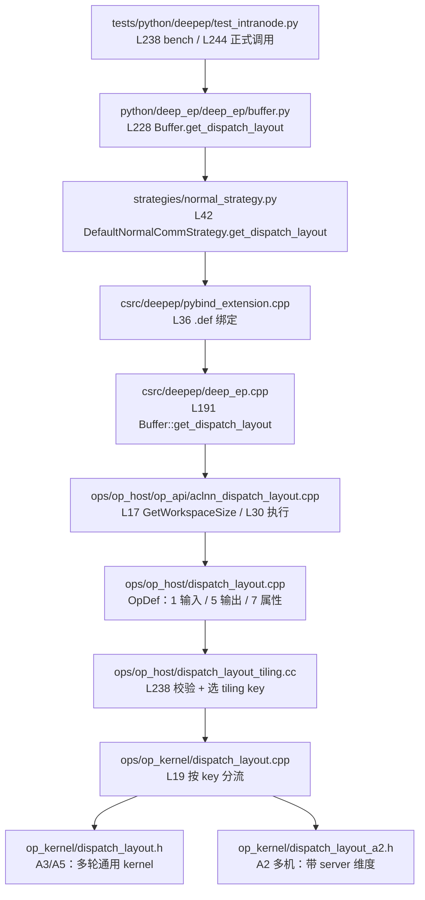

# 从「我有一只猫」到 dispatch：test 全流程逐层解析

本文按 `test_intranode.py` 的实际执行顺序，逐层说明**进入哪个文件、调用哪个算子、得到什么**，并用一个迷你例子贯穿全部数字。

---

## 1. 范围与边界

| 事项 | 是否在本仓库 |
|---|---|
| 文本 → tokenizer → token id | ❌ 仓库外（SGLang / HF tokenizers） |
| token id → embedding → hidden state | ❌ 仓库外（模型前向） |
| gate / router → top-k 路由 | ❌ 仓库外（模型前向） |
| `hidden_states` + `topk_idx` → 分发 / 合并 | ✅ 本仓库 |
| 专家 FFN 计算 | ⚠️ 仅 fused 模式在本仓库；normal 模式下在仓库外 |

**本仓库的第一眼输入是 `x` 和 `topk_idx`，不是文字。**

---

## 2. 迷你示例设定

为了数字可追踪，本文用一套小配置；括号内为 test 的默认值。

| 参数 | 本文示例 | test 默认 |
|---|---|---|
| `num_ranks` | 2（rank0、rank1） | 16 |
| `num_experts` | 8 | 256 |
| `experts_per_rank` | 4（rank0 拥有 0~3，rank1 拥有 4~7） | 16 |
| `num_topk` | 2 | 8 |
| `hidden` | 8 | 7168 |
| `num_tokens`（本 rank） | 4 | 4096 |

---

## 3. 「我有一只猫」如何走到仓库门口

### 3.1 仓库外三步（示意，非真实词表）

```
"我有一只猫"
  ↓ chat template
"<user>我有一只猫</user>"
  ↓ tokenizer.encode
input_ids = [1024, 2048, 3072, 4096]        # 4 个 token，仅示意
  ↓ embedding lookup
hidden = [[0.12, -0.34, ...], ...]          # [4, 7168] bf16
  ↓ gate: Linear(hidden) → softmax → top-k
topk_idx     = [[2, 5], [0, 7], [3, 4], [1, 5]]      # [4, 2] int64，全局专家号
topk_weights = [[0.6, 0.4], [0.7, 0.3], [0.5, 0.5], [0.9, 0.1]]  # [4, 2] fp32
```

逐 token 含义：

| token | 文本 | 选中的专家 | 权重 |
|---|---|---|---|
| 0 | 我 | 2、5 | 0.6 / 0.4 |
| 1 | 有 | 0、7 | 0.7 / 0.3 |
| 2 | 一只 | 3、4 | 0.5 / 0.5 |
| 3 | 猫 | 1、5 | 0.9 / 0.1 |

### 3.2 进入本仓库的三个张量

| 张量 | 形状 | dtype | 含义 |
|---|---|---|---|
| `x` | `[4, 8]` | bf16 | 每个 token 的 hidden 向量 |
| `topk_idx` | `[4, 2]` | int64 | 每条选择的目标**专家号**（0~7） |
| `topk_weights` | `[4, 2]` | fp32 | 对应的门控权重 |

三个张量的第 0 维必须对齐：`x[i]` 与 `topk_idx[i]` 是同一个 token。

---

## 4. 第 1 步：test_intranode.py

文件：`tests/python/deepep/test_intranode.py`

### 4.1 `__main__`：13 个参数（L593-668）

| 参数 | 默认 | 本文示例取值 |
|---|---|---|
| `--num-processes` | 16 | 2 |
| `--num-tokens` | 4096 | 4 |
| `--hidden` | 7168 | 8 |
| `--num-topk` | 8 | 2 |
| `--num-experts` | 256 | 8 |
| `--active-ranks` | `""` | 不使用 |
| `--topk-drop-prob` | 0.0 | 0 |
| `--topk-drop-row` | -1 | 不丢 |
| `--enable-dynamic-tokens` | False | 关 |
| `--enable-diagnose` | False | 关 |
| `--use-fp8` / `--use-mxfp4` / `--use-mxfp8` | False | 关（走 bf16） |

### 4.2 `spawn` 拉起进程（L670-673）

```python
torch.multiprocessing.spawn(test_loop, args=(num_processes, args), nprocs=num_processes)
```

- 起 `num_processes` 个子进程
- 每个子进程收到 `(local_rank, num_processes, args)`
- `args` 在所有进程里**完全相同**

### 4.3 `test_loop`（L572-590）

#### ① `init_dist`（L573）

`rank = 0/1`、`num_ranks = 2`、`group`；同时 `set_device(local_rank)`。

#### ② 创建 Buffer（L576-578）

```python
buffer = deep_ep.Buffer(group, int(2e9), 0, low_latency_mode=False, num_qps_per_rank=1)
```

**Buffer 是什么**：不是数据缓冲区，而是"通信上下文句柄"：

| 内容 | 来源 |
|---|---|
| 拓扑坐标 `rank / num_ranks / rdma_rank / nvl_rank` | C++ 构造函数计算 |
| `soc_version` | `GetSocVersion()` |
| HCCL 通信域名 | `backend.get_hccl_comm_name(rank)` |
| 三套策略实例 | `DEEP_USE_MODE` + 注册表 |
| `round` / `per_round_tokens` | 环境变量 |
| `[A5]` 分层通信上下文 | `LayeredCommContextManager` |

注意：`int(2e9)` 在这个移植版中**只被保存，没有被用于分配显存**；kernel 用的窗口地址由算子侧通过 `hcom_ep_name` 取得。

#### ③ 随机种子（L580-583）

```python
seed = int.from_bytes(os.urandom(4), "little")
torch.manual_seed(seed); torch.npu.manual_seed(seed)
```

各进程种子不同 → `topk_idx` 数据不同；但 `args` 相同。

### 4.4 `test_main`：args → 局部变量（L33-35）

```python
base_num_tokens, hidden = args.num_tokens, args.hidden
num_topk, num_experts   = args.num_topk, args.num_experts
enable_diagnose         = args.enable_diagnose
```

### 4.5 造 `topk_idx` / `topk_weights`（L83-131）

无 `--active-ranks` 时：

```python
scores = torch.randn((num_tokens, num_experts)).abs() + 1        # [4, 8]
topk_idx = torch.topk(scores, num_topk, dim=-1, sorted=False)[1] # [4, 2] int64
topk_weights = torch.ones((num_tokens, num_topk)) * rank         # [4, 2] fp32
```

本文示例的 `topk_idx`：

```
[[2, 5],
 [0, 7],
 [3, 4],
 [1, 5]]
```

### 4.6 专家号 → rank 号（L164-166）

```python
rank_idx = topk_idx // experts_per_rank    # 4
inplace_unique(rank_idx, num_ranks)
```

`declaration`：`experts_per_rank = num_experts // num_ranks = 8 // 2 = 4`。
因分区连续，专家 e 所属 rank = `e // 4`：

| token | 专家 | rank |
|---|---|---|
| 0 | 2, 5 | 0, 1 |
| 1 | 0, 7 | 0, 1 |
| 2 | 3, 4 | 0, 1 |
| 3 | 1, 5 | 0, 1 |

`inplace_unique` 之后仍是 `[0,1]`（本身无重复 rank）。

### 4.7 三张布局表（手工参考值，L199-236）

| 表 | 本文示例值 | 算法 |
|---|---|---|
| `num_tokens_per_expert` | `[1,1,1,1,1,2,0,1]` | 每个专家被选中的次数 |
| `num_tokens_per_rank` | `[4,4]` | 本 rank 发往各 rank 的 token 数（去重） |
| `is_token_in_rank` | `[[1,1],[1,1],[1,1],[1,1]]` | 每个 token 是否要发给该 rank |

逐专家核对：e0←t1(1)、e1←t3(1)、e2←t0(1)、e3←t2(1)、e4←t2(1)、e5←t0,t3(2)、e6(0)、e7←t1(1)，合计 8 = `4 tokens × 2 topk`。

### 4.8 调用第一个算子 `get_dispatch_layout`（L238-251）

> 这一节的调用链、每一层代码、每一步计算在第 15 节被逐层拆开（含「猫」的逐 core 推演），此处只保留流程位置。

```python
bench(lambda: buffer.get_dispatch_layout(topk_idx, num_experts))
...
ref_num_tokens_per_rank, _, ref_num_tokens_per_expert, ref_is_token_in_rank, _ = \
    buffer.get_dispatch_layout(topk_idx, num_experts)
```

- **输入**：`topk_idx [4,2] int64` + `num_experts=8`
- **输出**：3 张布局表（形状见上）
- 随后 L253-261 与手工值断言比对
- **这是本仓库执行的第一个算子**，但它只算"计划"，不搬数据

### 4.9 造 `Config` 和 `x`（L263-269）

```python
config = deep_ep.Config(24, 8, 256)
x = torch.ones((num_tokens, hidden), dtype=torch.bfloat16) * rank   # [4, 8]
```

`x` 每行填 `rank`，便于校验"收到的数据来自哪个 rank"。

### 4.10 组建参数并调用 `dispatch`（L529-539）

```python
dispatch_args = {
    "x": x,
    "num_tokens_per_rank": ref_num_tokens_per_rank,
    "is_token_in_rank": ref_is_token_in_rank,
    "num_tokens_per_expert": ref_num_tokens_per_expert,
    "config": config,
    "topk_idx": topk_idx,
    "topk_weights": topk_weights,
}
recv_x, _, _, _, handle, _ = buffer.dispatch(**dispatch_args)
```

**test 中真正开始搬 token 的语句**：

| 行 | 语句 | 说明 |
|---|---|---|
| L484 | `bench(lambda: buffer.dispatch(**tune_args_bf16))` | 首次触发（bench warmup） |
| L521 | `bench(... tune_args_quant)` | 量化路径（本例不执行） |
| L539 | `buffer.dispatch(**dispatch_args)` | **正式调用** |

### 4.11 combine（L542-549）

```python
buffer.combine(x=recv_x, handle=handle, config=config, topk_weights=handle[7])
```

只有 L539 返回的 `handle` 才能用于 combine。

---

## 5. 第 2 步：buffer.py

文件：`python/deep_ep/deep_ep/buffer.py`，函数 `Buffer.dispatch`（L297-407）。

只做三件事：

```python
config = self.get_dispatch_config(self.group_size) if config is None else config   # L381
quant_mode = _resolve_quant_mode(use_fp8, use_mxfp4, use_mxfp8)                    # L384
...                                                                                # 全 False 时读 DEEP_NORMAL_MODE_USE_INT8_QUANT
return self.normal_strategy.dispatch(..., quant_mode=quant_mode)                   # L387
```

| 动作 | 本例结果 |
|---|---|
| 补 `config` | 已传，不触发 |
| 解析量化 | 三个 bool 全 False，且未设 env → `quant_mode = "bf16"` |
| 转发 | 调 `DefaultNormalCommStrategy.dispatch` |

**数据形状、dtype 一律不变。**

---

## 6. 第 3 步：normal_strategy.py

文件：`python/deep_ep/deep_ep/strategies/normal_strategy.py`，`DefaultNormalCommStrategy.dispatch`（L76 起）。

| 动作 | 位置 | 本例 |
|---|---|---|
| 判定单机/多机 | L103 `if self.runtime.get_num_rdma_ranks() > 1` | 2 卡单机、`num_rdma_ranks=1` → 走 intranode |
| 多机时禁用量化 | L104-111 | 不触发 |
| 组参并下发 | 约 L200-232 | 调 `runtime.intranode_dispatch(...)` |
| 打包 handle | 约 L234-243 | 返回给 test |

`num_rdma_ranks` 的值由 C++ 构造函数决定：

| 卡 | `num_rdma_ranks` |
|---|---|
| A2 | `num_ranks / 8`（本例 2 卡 → 1） |
| A3/A5 | 默认 1；设 `DEEPEP_LAYERED_RANKS_PER_SERVER` 且多机时 > 1 |

---

## 7. 第 4-5 步：pybind → deep_ep.cpp

### 7.1 pybind（`csrc/deepep/pybind_extension.cpp` L17-56）

纯绑定，无逻辑：Python 的 `runtime.intranode_dispatch(...)` → C++ `Buffer::intranode_dispatch`。

### 7.2 C++ `Buffer::intranode_dispatch`（`csrc/deepep/deep_ep.cpp` L279-504）

| 步骤 | 位置 | 本例动作 |
|---|---|---|
| 1. 取形状 | L318 | `num_tokens=4`、`hidden=8` |
| 2. `topk_idx` 转 int32 | L325 | int64 → int32 |
| 3. 分配中间张量 | L358-387 | `send_data`、`send_data_offset`、`send_token_idx_small`、`recv_*`、`expert_global_offset` 等 |
| 4. 按 `quant_mode` 定输出 | L433-458 | bf16 → `expandx_out [*, 8] bf16`，无 scales |
| 5. 下发 notify | L399 | `EXEC_NPU_CMD(aclnnNotifyDispatch, ...)` |
| 6. 下发 dispatch | L464 | `EXEC_NPU_CMD(aclnnCamMoeDispatchNormal, ...)` |

参数在 L464-469 一次摆好 23 个：9 个输入张量、4 个输出张量、若干标量（`num_ranks`、`rank`、`tp_size`、`tp_rank`、`num_experts`、`quant_mode`、`real_max_bs`、`global_bs`、`round`、`per_round_tokens`）。

---

## 8. 第 6 步：notify 算子（只算计划，不搬 token）

| 层 | 文件 |
|---|---|
| aclnn 接口 | `csrc/deepep/ops/op_host/op_api/aclnn_notify_dispatch.cpp` |
| OpDef | `csrc/deepep/ops/op_host/notify_dispatch.cpp` |
| Tiling | `csrc/deepep/ops/op_host/notify_dispatch_tiling.cc` |
| Kernel | `csrc/deepep/ops/op_kernel/notify_dispatch.cpp` → `notify_dispatch.h`（A3）/ `notify_dispatch_a5.h`（A5） |
| A2 版本 | `csrc/deepep/ops2/op_host/op_api/aclnn_notify_dispatch.cpp`（构建时替换） |

产出（本例）：

| 张量 | 内容 |
|---|---|
| `send_data_offset[8]` | 各专家区段起点：`[0,1,2,3,4,5,7,7]` |
| `send_token_idx_small[8]` | 每个 (token,k) 在目标专家队列中的槽号：idx0~idx7 依次 `[0,0,0,0,0,0,1,0]` |
| 各 rank 收发计数 | 用于后续容量校验 |

展开顺序 idx = token × `num_topk` + k：

| idx | (token, k) | 专家 | 目标 rank | 槽号 |
|---|---|---|---|---|
| 0 | (0,0) | 2 | 0 | 0 |
| 1 | (0,1) | 5 | 1 | 0 |
| 2 | (1,0) | 0 | 0 | 0 |
| 3 | (1,1) | 7 | 1 | 0 |
| 4 | (2,0) | 3 | 0 | 0 |
| 5 | (2,1) | 4 | 1 | 0 |
| 6 | (3,0) | 1 | 0 | 0 |
| 7 | (3,1) | 5 | 1 | 1 |

---

## 9. 第 7 步：真正搬运（cam_moe_dispatch_normal）

### 9.1 文件链路

| 层 | 文件 |
|---|---|
| aclnn 接口 | `ops/op_host/op_api/aclnn_cam_moe_dispatch_normal.cpp` |
| OpDef | `ops/op_host/cam_moe_dispatch_normal.cpp`（9 Input / 4 Output / 11 Attr；L108-111 注册 SoC；L116 `OP_ADD`） |
| InferShape | `ops/op_host/cam_moe_dispatch_normal_infer.cpp` |
| Tiling | `ops/op_host/cam_moe_dispatch_normal_tiling.cc` |
| Tiling 结构 | `ops/op_kernel/cam_moe_dispatch_normal_tiling.h` |
| Kernel 入口 | `ops/op_kernel/cam_moe_dispatch_normal.cpp` |
| A3 实现 | `ops/op_kernel/cam_moe_dispatch_normal.h` |
| A5 实现 | `ops/op_kernel/cam_moe_dispatch_normal_a5.h` |
| A2 版本 | `ops2/op_host/op_api/aclnn_cam_moe_dispatch_normal.cpp` 等 |

### 9.2 tiling key（决定走哪份 kernel）

`ops/op_kernel/cam_moe_dispatch_normal.cpp` L10-16：

| key | 场景 |
|---|---|
| 13000 / 13002 | A3，无量化 / 量化 |
| 15000 / 15002 | A5，无量化 / 量化 |
| 15003 / 15004 / 15005 | A5，MXFP8 / MXFP4 / PerTokenFP8 |

本例 bf16 + A3 → `13000`。

### 9.3 kernel 执行四步

`Process`（`cam_moe_dispatch_normal.h` L766-785）：

| 步 | 函数 | 位置 | 本例 |
|---|---|---|---|
| ① | `InputToShare` | L380-476 | 把 8 个 (token,k) 条目写到目标 rank 窗口 |
| ② | `SetStatus` | L479 | 通知各目标 rank |
| ③ | `WaitStatus` | L530-634 | 等所有源 rank 到齐 |
| ④ | `ShareToOutputLongSeq` | L686-763 | 按 (专家, 源 rank, 轮次) 摊到 `expandXOut` |

### 9.4 搬运地址怎么算

```cpp
// 实际代码 L443-450、L472（tokenIndex 是扁平化的 (token,k) 下标）
uint32_t dstExpertId = expertIdsTensor(tokenIndex - startTokenId);
if (dstExpertId < 0 || dstExpertId >= moeExpertNum) continue;    // -1 表示 drop
int32_t curExpertCnt    = sendTokenIdxTensor(tokenIndex - startTokenId);
int32_t dstExpertOffset = sendOffsetTensor(dstExpertId);         // 无 round 偏移
GM_ADDR rankGM = (uint8_t *)(shareGM + hOutGMAlignSize * (dstExpertOffset + curExpertCnt));
dstGT.SetGlobalBuffer((__gm__ ExpandXOutType *)rankGM);
DataCopyPad(dstGT, xTmpTensor, hCommuCopyOutParams);             // 只搬 hScaleIdxSize 字节
```

| 变量 | 来源 | 索引口径 |
|---|---|---|
| `tokenIndex` | 核内循环 | 扁平 (token,k)：`token = tokenIndex/topK`，`k = tokenIndex%topK` |
| `expertIdsTensor` | `topk_idx`（转 int32） | UB 分片，必须减 `startTokenId` |
| `sendTokenIdxTensor` | layout 的 `send_token_idx_small` | 同上，段内槽号 |
| `sendOffsetTensor` | notify 的 `send_data_offset` | 长度 = 全局专家数，`sendOffset[e]` = 前 e 个专家槽数前缀和 |
| `shareGM` | `Init` L289：`GetWindAddrByRankId(COMM_EP_IDX, epRankId)` | **本 rank** 窗口数据区基址（已含 `winDataSizeOffset + dataOffset`） |
| `hOutGMAlignSize` | `Init` L258 | 单槽步长（512B 对齐） |

代入 idx7：(token=3, k=1)，专家 5，槽号 1，`sendOffset[5]=5`：

```
槽号 = 5 + 1 = 6
rankGM = shareGM + 512 × 6
```

即「专家 5」区段的第 6 号槽（0-based，也就是该段第 2 个槽、整体第 7 个槽）。

**注意写的是发送方自己的窗口**：`shareGM` 用的是 `epRankId`（本卡），所以 rank0 把这 3 份数据（payload + 32B scale + 三元组）写进 **rank0 的窗口**；rank1 作为专家 5 的 owner，稍后通过 `GetWindAddrByRankId(COMM_EP_IDX, fromRank=0)` 从 **rank0 的窗口**按同一偏移读走。

同时 `FillTriple`（L368-375）在槽内写入回程三元组 `(epRankId, roundIndex*perRoundTokens + token/topK, k)`，供 combine 找回原 token。

### 9.5 重排（本 rank 接收侧）

`ShareToOutputLongSeq`（L719-762）**不做排序**，它只是把 notify 预先算好的三张偏移表相加，再按固定顺序遍历：`i = local_e*epRankSize + fromRank`，所以顺序天然是 **本地专家 → 源 rank → 轮次 → 该来源内的第 j 条**。

下面用完整数据推一遍。先补齐输入（原示例只给了 rank0 的 `topk_idx`，缺 rank1 的表，导致结果看起来凭空出现）。

**归属规则**（`test_intranode.py` L81、L164）：

```python
experts_per_rank = num_experts // num_ranks     # 8 // 2 = 4
rank = expert_id // experts_per_rank            # 0~3→rank0，4~7→rank1
```

**rank0 的 topk_idx**

| token | topk_idx | 归属 |
|---|---|---|
| 0 | `[2, 5]` | e2 本地，e5 发 rank1 |
| 1 | `[0, 7]` | e0 本地，e7 发 rank1 |
| 2 | `[3, 4]` | e3 本地，e4 发 rank1 |
| 3 | `[1, 5]` | e1 本地，e5 发 rank1 |

**rank1 的 topk_idx**（手工构造，使其向 rank0 的 e0、e2 各发 1 条）

| token | topk_idx | 归属 |
|---|---|---|
| 0 | `[0, 6]` | e0 发 rank0，e6 本地 |
| 1 | `[7, 2]` | e7 本地，e2 发 rank0 |
| 2 | `[5, 6]` | 两条都本地 |
| 3 | `[4, 5]` | 两条都本地 |

> token 编号是 **rank 内局部编号**，rank0.token0 与 rank1.token0 是两个不同 token；跨 rank 唯一定位必须靠 `(rank, token)` 二元组。

#### ① recvCount：rank0 按 (专家, 源rank) 计数

展平下标 `i = local_e*epRankSize + fromRank`：

| i | (专家, 源) | 来自谁 | count |
|---|---|---|---|
| 0 | (e0, r0) | rank0.token1 | 1 |
| 1 | (e0, r1) | rank1.token0 | 1 |
| 2 | (e1, r0) | rank0.token3 | 1 |
| 3 | (e1, r1) | 无 | 0 |
| 4 | (e2, r0) | rank0.token0 | 1 |
| 5 | (e2, r1) | rank1.token1 | 1 |
| 6 | (e3, r0) | rank0.token2 | 1 |
| 7 | (e3, r1) | 无 | 0 |

合计 6 条 → `expandXOut` 6 行。

#### ② 前缀（kernel 用相邻前缀相减得到 count）

```
i:      0  1  2  3  4  5  6  7
前缀:   1  2  3  3  4  5  6  6
```

#### ③ 三张偏移表（notify 三个专用核算出）

**expert_global_offset**：每专家总接收量 → 专家维前缀

```
e0=2, e1=1, e2=2, e3=1
expTensor(0) = 0
expTensor(1) = 0 + 2 = 2
expTensor(2) = 2 + 1 = 3
expTensor(3) = 3 + 2 = 5
→ [0, 2, 3, 5]     长度 = num_local_experts = 4，下标 0~3
```

> 表里**没有末尾的总数**。总行数 6 = 2+1+2+1，由 `recvCount` 前缀的最后一项 / `total_recv_token` 给出。写 `[0,2,3,5,6]`（E+1 个元素）是另一种“前缀+总数”形式，代码里不是这样存的。

**srcrank_in_expert_offset**：专家内按源 rank 前缀

```
e0: [0,1]  e1: [0,1]  e2: [0,1]  e3: [0,1]  →  [0,1, 0,1, 0,1, 0,1]
```

**r_in_srcrank_offset**：仅 1 轮 → 全 0。

#### ④ 三数相加得行号

`writeOffset = expert_global_offset[local_e] + srcrank_in_expert_offset[i] + r_in_srcrank_offset[i]`

| i | 专家起点 | 段内偏移 | 轮次 | **writeOffset** | 内容 |
|---|---|---|---|---|---|
| 0 | 0 | 0 | 0 | **0** | e0 ← rank0.token1 |
| 1 | 0 | 1 | 0 | **1** | e0 ← rank1.token0 |
| 2 | 2 | 0 | 0 | **2** | e1 ← rank0.token3 |
| 3 | — | — | — | 跳过（count=0） | — |
| 4 | 3 | 0 | 0 | **3** | e2 ← rank0.token0 |
| 5 | 3 | 1 | 0 | **4** | e2 ← rank1.token1 |
| 6 | 5 | 0 | 0 | **5** | e3 ← rank0.token2 |
| 7 | — | — | — | 跳过（count=0） | — |

#### ⑤ 最终产物

| 行号 | 专家 | 数据来源 | `expandIdxOut` 三元组 (源rank, 源token, k) |
|---|---|---|---|
| 0 | e0 | rank0.token1 | `(0, 1, 0)` |
| 1 | e0 | rank1.token0 | `(1, 0, 0)` |
| 2 | e1 | rank0.token3 | `(0, 3, 0)` |
| 3 | e2 | rank0.token0 | `(0, 0, 0)` |
| 4 | e2 | rank1.token1 | `(1, 1, 1)` |
| 5 | e3 | rank0.token2 | `(0, 2, 0)` |

| 张量 | 形状（本例） | 说明 |
|---|---|---|
| `expandXOut` | `[6, 8]` bf16 | 本地专家收到的总数决定行数 |
| `dynamicScalesOut` | 无（bf16） | 量化时才有 |
| `expandIdxOut` | `[6, 3]` int32 | 逆置换表，combine 用 |
| `recv_count` | `[round, 8]` | 每 (专家,源rank) 计数 |

#### 重排的目的

1. **完成 token-major → expert-major 的转置。** MoE 的 FFN 是按专家分组计算的，`expandXOut` 必须把“同一专家的 token”放在连续行，否则专家 GEMM 前还要再 gather 一次。
2. **让每个专家有可直接切片的连续段。** 专家 e 的数据就是 `expandXOut[expertGlobalOffset[e] : +total[e]]`，下游 `grouped_matmul` 按这个区间取指针即可，零额外索引计算。
3. **与 `num_tokens_per_expert` 一一对应。** 段边界即专家 token 数，可直接用于核间任务划分与负载均衡。
4. **同专家内按源 rank 分段，给 combine 留反查锚点。** `srcrank_in_expert_offset` 让 combine 能按“哪个 rank 发来的”整段回送，不必逐条查表。
5. **轮次放最内层，保证长序列多轮时顺序稳定。** round 0 的行全部排在 round 1 之前，combine 反向拼回时不需跨轮重排。
6. **`expandIdxOut` 保存逆置换。** 三元组 `(源rank, 源token, k)` 让 combine 能把专家输出精确送回原 token 的原 topk 槽位，这是“可逆”的关键。

---

## 10. 第 8 步：返回

`deep_ep.cpp` → strategy 打包 `handle` → test 拿到：

```python
recv_x, recv_topk_idx, recv_topk_weights, recv_num_tokens_per_expert_list, handle, event
```

`handle` 里保存了 `handle[7] = recv_topk_weights` 等，供 combine 使用。

---

## 11. 每层的数据形态对照

| 层 | `x` | `topk_idx` | 新增产物 |
|---|---|---|---|
| test | `[4, 8] bf16` | `[4, 2] int64` | `x`/`topk_weights` |
| buffer.py | 原样 | 原样 | `quant_mode="bf16"` |
| strategy | 原样 | 原样 | 选择 intranode |
| deep_ep.cpp | 原样 | `[4,2] int32` | `send_data*`、`recv_*` 等 |
| notify kernel | — | 读取 | `sendOffset[8]`、`sendTokenIdx[8]` |
| dispatch kernel | 读 `x[token]` | 读 | 写窗口 → `expandXOut [*,8]`、`expandIdxOut [*,3]` |

---

## 12. 三种卡差异总表

| 维度 | A2 | A3 | A5 |
|---|---|---|---|
| 构建命令 | `build.sh -a deepep2` | `build.sh -a deepep` | `build.sh -a deepep Ascend950` |
| 算子目录 | `ops2/` | `ops/` | `ops/` + `__DAV_C310__` |
| 拓扑 | 8 卡 HCCS 一组（`deep_ep.cpp:92-97`） | 全互联；可选 layered | 同 A3；layered 建 `LayeredCommContextManager` |
| 分层协议 | 不涉及 | 仅 `roce` | `roce` / `uboe` |
| low-latency 算法串 | `fullmesh` | `fullmesh_v1` / `ccu` | 同 A3 |
| 量化 | `int8` | `int8` | `int8` / `pertoken_fp8` / `mx_fp8` / `mx_fp4` |
| tiling key | ops2 内定 | 13000/13002 | 15000/15002/15003/15004/15005 |
| kernel 文件 | ops2 同名 | `cam_moe_dispatch_normal.h` | `cam_moe_dispatch_normal_a5.h` |
| 测试入口 | 完全相同 | 完全相同 | 完全相同 |

---

## 13. 常见误解更正

1. **本仓库不做 tokenization**：`tokenizer` / `vocab` / embedding 均无业务代码；输入是 hidden state。
2. **`num_tokens` 不是参数**：它是 `x.shape[0]`，由上游 batch 决定，`deep_ep.cpp:318` 读取。
3. **`Buffer` 不分配显存**：`num_nvl_bytes`（test 传 2e9）仅被保存，未被使用。
4. **`Config` 的 `256` 未被使用**：只有 `num_sms` 参与 `num_channels = num_sms/2`。
5. **`num_experts` 是唯一显式传入的整型业务参数**；`hidden`、`num_topk` 都隐含在张量形状里。
6. **intranode/internode 不在 buffer.py 判断**：在 `normal_strategy.py:103`，依据是 C++ 构造时算好的 `num_rdma_ranks`。
7. **协议选项是 `roce` / `uboe`**，没有名为 "rdma" 的选项；非 layered 跨机由 HCCL 自行决定。
8. **"8 卡"是 A2 的 HCCS 域常量，"fullmesh"是 low-latency 算法串**，二者不是同一维度。
9. **策略在构造时绑定**（`DEEP_USE_MODE`），量化在每次调用时判断。
10. **正确性校验默认不跑**：`check_data` 调用被注释，`test_diagnose` 需 `--enable-diagnose`；默认只做布局断言和带宽测量。
11. **第 1 步就会执行算子**：`get_dispatch_layout` 是第一个；`dispatch` 是第二个链路。
12. **combine 依赖 handle**：主流程中 combine 只在 bench 与 diagnose 里出现。

---

## 14. 文件索引

| 层 | 路径 |
|---|---|
| 测试入口 | `tests/python/deepep/test_intranode.py` |
| 测试工具 | `tests/python/deepep/utils.py` |
| Python API | `python/deep_ep/deep_ep/buffer.py` |
| 量化解析 | `python/deep_ep/deep_ep/utils.py`、`device_info.py` |
| 策略抽象/注册表 | `python/deep_ep/deep_ep/ep_strategy.py` |
| 策略实现 | `python/deep_ep/deep_ep/strategies/{normal,low_latency,fused}_strategy.py` |
| pybind | `csrc/deepep/pybind_extension.cpp` |
| C++ Buffer | `csrc/deepep/deep_ep.cpp`、`deep_ep.hpp`、`config.{hpp,cpp}` |
| layout 算子 | `ops/op_host/{dispatch_layout.cpp,dispatch_layout_tiling.cc}`、`ops/op_kernel/{dispatch_layout.cpp,dispatch_layout.h,dispatch_layout_a2.h}` |
| notify 算子 | `ops/op_host/{notify_dispatch.cpp,notify_dispatch_tiling.cc}`、`ops/op_kernel/notify_dispatch.{cpp,h,_a5.h}` |
| dispatch 算子 | `ops/op_host/cam_moe_dispatch_normal*.{cpp,cc}`、`ops/op_kernel/cam_moe_dispatch_normal*.{cpp,h}` |
| combine 算子 | `ops/op_host/op_api/aclnn_cam_moe_combine_normal.cpp`、`ops/op_kernel/cam_moe_combine_normal*.h` |
| aclnn 接口 | `ops/op_host/op_api/aclnn_*.cpp` |
| A2 构建 | `ops2/` 下同名文件 |

---

## 15. 深挖第一个算子：`get_dispatch_layout` 全链路

> 本章回答：`topk_idx` 从 test 出发后，**依次进了哪 9 个文件**、每个文件里**发生了什么**、最终**三张布局表怎么算出来**。
> 全程用第 3 节的「我 / 有 / 一只 / 猫」示例：`num_ranks=2`、`num_experts=8`、`experts_per_rank=4`、`num_topk=2`、`num_tokens=4`。

### 15.1 9 层调用链总览



| # | 层 | 文件 : 位置 | 这一层做了什么 | 数据形态变化 |
|---|---|---|---|---|
| 1 | 测试 | `test_intranode.py:238,244` | 传入 `topk_idx`、`num_experts`，接 5 元组返回值 | `[4,2] int64` 原样 |
| 2 | Python API | `buffer.py:228-264` | 纯转发给 `normal_strategy` | 不变 |
| 3 | 策略 | `normal_strategy.py:42-70` | 记住 `num_experts`，调 C++ runtime，包 `EventOverlap` | 不变 |
| 4 | 绑定 | `pybind_extension.cpp:36` | `.def` 直绑，无逻辑 | 不变 |
| 5 | C++ 宿主 | `deep_ep.cpp:191-260` | 6 项断言、分配 3 张输出表 + 2 块内部表、拼 13 个参数、调算子、存成员 | 新增 5 个张量 |
| 6 | aclnn | `op_api/aclnn_dispatch_layout.cpp:17-36` | 两段式：取 workspace → 真正执行；设 HCCL ServerType=MTE | 转 `aclTensor*` |
| 7 | 算子原型 | `op_host/dispatch_layout.cpp:4-79` | 声明 dtype/format/属性、注册 3 种 SoC 配置 | 不变 |
| 8 | Tiling | `op_host/dispatch_layout_tiling.cc:238-274` | 10 余项合法性检查、填 tiling 结构、定 `tilingKey`、`blockDim` | 生成 tiling 常量 |
| 9 | Kernel | `op_kernel/dispatch_layout.cpp:19-29` | 按 key 选 `DispatchLayout` 或 `DispatchLayoutA2` | 写 5 个 GM 输出 |

**关键结论：这个算子不通信。** 全程没有 HCCL 调用，只做「本 rank 的计数与编号」；真正的跨卡交换在下一步 notify 里发生。

---

### 15.2 第 1 层：test_intranode.py

```python
# L238：先跑一次用于计时
t = bench(lambda: buffer.get_dispatch_layout(topk_idx, num_experts))[0]
# L244-251：再跑一次，取真正返回值
return_values = buffer.get_dispatch_layout(topk_idx, num_experts)
(ref_num_tokens_per_rank, _, ref_num_tokens_per_expert, ref_is_token_in_rank, _) = return_values
```

- 输入只有两个：`topk_idx`（`[4,2] int64`）和 `num_experts=8`。
- 第 2 个返回值（`num_tokens_per_rdma_rank`）和第 5 个（`event`）在本例恒为 `None`。
- L253-261 用 L199-236 的 torch 手算值做 `allclose` 断言：

```python
# L200-214：参考值 = 逐轮、逐专家统计 (chunk_topk == expert_id).sum()
num_tokens_per_expert[round_id * num_experts + expert_id] = (chunk_topk == expert_id).sum()
# L225-234：参考值 = 每个 rank 有多少 token，以及 token 是否出现在该 rank
token_sel = (rank_idx == i).max(dim=-1)[0]
is_token_in_rank = (token_idx_in_rank >= 0).to(torch.int)
```

注意 `gbl_num_tokens_per_expert` / `gbl_num_tokens_per_rank` 的 `all_reduce`（L217、L236）**不参与断言**，只是打印时的全局视角；断言比的是本 rank 值。

### 15.3 第 2 层：buffer.py

```python
# L258-264
return self.normal_strategy.get_dispatch_layout(
    topk_idx=topk_idx, num_experts=num_experts,
    previous_event=previous_event, async_finish=async_finish,
    allocate_on_comm_stream=allocate_on_comm_stream,
)
```

- 只有一句转发，没有任何形状/量化处理（对比 `dispatch` 会补 `config`、解析 `quant_mode`）。
- docstring 已写清契约：`topk_idx` 必须 `[num_tokens, num_topk]`、`int64`、`-1` 表示未选中；`num_tokens_per_rdma_rank` 在单机场景返回 `None`。

### 15.4 第 3 层：normal_strategy.py

```python
# L42-70，DefaultNormalCommStrategy.get_dispatch_layout
self.num_experts = num_experts
(num_tokens_per_rank, num_tokens_per_rdma_rank,
 num_tokens_per_expert, is_token_in_rank, event) = self.runtime.get_dispatch_layout(
    topk_idx, num_experts,
    getattr(previous_event, "event", None), async_finish, allocate_on_comm_stream)
return (num_tokens_per_rank, num_tokens_per_rdma_rank,
        num_tokens_per_expert, is_token_in_rank, EventOverlap(event))
```

- `self.runtime` 是 `Buffer.__init__`（`buffer.py` L75-82）构造出来的 C++ 对象。
- 这一层只做两件事：把 `previous_event` 从 `EventOverlap` 拆成底层 `event`；把 C++ 返回的 `event` 再包成 `EventOverlap`。
- 若是 `DEEP_USE_MODE=alltoall`，走的是同文件 L452 `AlltoAllNormalCommStrategy.get_dispatch_layout`——**完全不同实现**：用 `torch.histc` + `_gather_along_first_dim` 做全组 all-gather，是通信型的布局计算。本文示例用默认策略，不进入该分支。

### 15.5 第 4 层：pybind_extension.cpp

```cpp
// L36
.def("get_dispatch_layout", &deep_ep::Buffer::get_dispatch_layout)
```

- 直接绑定成员函数指针，Python 的 `int` → C++ `int`，Python `None` → `std::optional<EventHandle>`，返回值 `std::tuple<...>` → Python `tuple`。
- 无参数校验、无 dtype 转换。

### 15.6 第 5 层：C++ `Buffer::get_dispatch_layout`

文件 `csrc/deepep/deep_ep.cpp` L191-260，逐步拆：

| 行 | 代码 | 本例结果 |
|---|---|---|
| L195-196 | 断言 `topk_idx.dim()==2` 且 `is_contiguous()` | 通过 |
| L197 | 断言 `num_experts > 0` | 8 > 0 |
| L198-199 | `num_tokens = topk_idx.size(0)`；`num_topk = topk_idx.size(1)` | 4；2 |
| L200 | `num_tokens ≤ MAX_TOTAL_TOKENS`（131072） | 4 ≤ 131072 |
| L202-205 | `per_round_tokens ∈ [MIN_TOKENS_PER_ROUND=32, MAX_TOKENS_PER_ROUND=8192]` | 默认 8192 |
| L206 | `rank ∈ [0, num_ranks)` | rank 0 或 1 |
| L207-210 | `configured_capacity = round * per_round_tokens`，断言 `num_tokens ≤ 它` | `1×8192 = 8192` |
| L212-214 | `actual_rounds = ceil(num_tokens / per_round_tokens)`，断言 `≤ MAX_ROUNDS=256` | `ceil(4/8192) = 1` |
| L215-216 | `local_ranksize = layered_mode ? num_nvl_ranks : 8`；`server_num = num_ranks / local_ranksize` | 8；`2/8 = 0`（整除） |

`round=1`、`per_round_tokens=8192` 来自构造函数 L154-181：未设 `DEEPEP_NORMAL_LONG_SEQ_ROUND` / `DEEPEP_NORMAL_LONG_SEQ_PER_ROUND_TOKENS` 时用默认值；两者必须同时设置。

接着分配 5 个张量（L219-244）：

```cpp
auto num_tokens_per_expert = at::zeros({round, num_experts}, kInt, device);   // [1,8]
auto num_tokens_per_rank   = at::zeros({num_ranks},        kInt, device);     // [2]
auto is_token_in_rank      = at::zeros({num_tokens, num_ranks}, kInt, device); // [4,2]
auto send_token_idx_small  = at::zeros({num_tokens, num_topk}, kInt, device); // [4,2]
auto notify_send_data      = at::zeros({notify_send_data_size}, kInt, device);
```

`notify_send_data_size` 公式（L222-223）：

```cpp
num_experts * EXPERT_DATA_SIZE + server_num
  + MAX_BATCH_SIZE * (1 + 2 * server_num + 2 * num_topk)
```

其中 `EXPERT_DATA_SIZE = 1 + MAX_BATCH_SIZE = 4097`（L37）。本例：`8×4097 + 0 + 4096×(1+0+4) = 32776 + 20480 = 53256` 个 int32。

L224-242 的注释说明这块缓冲区由 8 段组成（专家计数、server 去重计数、每 token 每 server 发送数、每 token 目标 server 数、发送顺序、每 (token,k) 槽位、每 (token,k) 专家号、每专家回填偏移）。本例 `server_num=0`，server 相关 3 段长度为 0。

然后一次下发（L246-248）：

```cpp
int32_t rank_id = static_cast<int>(rank);
EXEC_NPU_CMD(aclnnDispatchLayout, topk_idx, num_tokens, num_ranks, num_experts, num_topk,
             local_ranksize, per_round_tokens, rank_id,
             num_tokens_per_rank, num_tokens_per_expert,
             is_token_in_rank, notify_send_data, send_token_idx_small);
```

下发后把两块内部表挂在 Buffer 上（L250-252），供后续 dispatch 复用：

```cpp
this->notify_send_data    = notify_send_data;
this->send_token_idx_small = send_token_idx_small;
```

返回（L257-259）：

```cpp
auto num_tokens_per_expert_one_dim = num_tokens_per_expert.flatten();  // [round*8] = [8]
return {num_tokens_per_rank, std::nullopt, num_tokens_per_expert_one_dim,
        is_token_in_rank, std::nullopt};
```

**注意：layout 不做 int64→int32 转换**（对比 `intranode_dispatch` L325 会转），因为算子原型直接声明输入为 `DT_INT64`。

### 15.7 第 6 层：aclnn 两段式接口

`EXEC_NPU_CMD` 宏在 `csrc/deepep/pytorch_npu_helper.hpp:553-602`，展开后是 5 步：

1. `GetOpApiFuncAddr("aclnnDispatchLayoutGetWorkspaceSize")` / `"aclnnDispatchLayout"`：在算子 so 里 `dlsym` 出两个函数指针（首次调用后缓存为 `static`）。
2. `ConvertTypes(...)`：把 `at::Tensor` 转成 `aclTensor*`，把标量原样传，并在参数尾部追加 `workspace_size_addr`、`executor_addr`。
3. 调第一段 `GetWorkspaceSize`：只计算需要多少 workspace、构建 `aclOpExecutor`，**不执行 kernel**。
4. 按返回值 `at::empty({workspace_size}, kByte)` 在 NPU 上申请 workspace。
5. 用 `at_npu::native::OpCommand` 注册自定义 handler，在 `acl_stream` 上调第二段 `aclnnDispatchLayout(workspace, size, executor, stream)`，再 `cmd.Run()` 真正入队。

`aclnn_dispatch_layout.cpp` 本身是薄壳：

```cpp
// L25-27：第一段直接转发给代码生成器产出的 Inner 接口
return aclnnInnerDispatchLayoutGetWorkspaceSize(topkIdx, numTokens, numRanks, numExperts, numTopk,
    localRankSize, perRoundTokens, rankId, numTokensPerRank, numTokensPerExpert,
    isTokenInRank, notifySendData, sendTokenIdxSmall, workspaceSize, executor);

// L30-36：第二段先声明 HCCL 执行器用 MTE 引擎，再执行
NnopbaseSetHcclServerType(executor, NNOPBASE_HCCL_SERVER_TYPE_MTE);
return aclnnInnerDispatchLayout(workspace, workspaceSize, executor, stream);
```

`ops2/op_host/op_api/aclnn_dispatch_layout.cpp` 与此**逐字相同**，A2 的差异不在这层。

参数对应表（13 个）：

| 序号 | 参数 | 来源 | 本例值/形状 |
|---|---|---|---|
| 1 | `topkIdx` | `topk_idx` | `[4,2] int64` |
| 2 | `numTokens` | `topk_idx.size(0)` | 4 |
| 3 | `numRanks` | `num_ranks` | 2 |
| 4 | `numExperts` | 入参 | 8 |
| 5 | `numTopk` | `topk_idx.size(1)` | 2 |
| 6 | `localRankSize` | L215 | 8 |
| 7 | `perRoundTokens` | L167 默认 | 8192 |
| 8 | `rankId` | `rank` | 0 或 1 |
| 9 | `numTokensPerRank` | L220 输出 | `[2] int32` |
| 10 | `numTokensPerExpert` | L219 输出 | `[1,8] int32` |
| 11 | `isTokenInRank` | L221 输出 | `[4,2] int32` |
| 12 | `notifySendData` | L244 输出 | `[53256] int32` |
| 13 | `sendTokenIdxSmall` | L243 输出 | `[4,2] int32` |

### 15.8 第 7 层：OpDef（算子原型）

`ops/op_host/dispatch_layout.cpp`：

| 类别 | 内容 |
|---|---|
| 输入 | 1 个：`topkIdx`，`DT_INT64`，`FORMAT_ND` |
| 属性 | 7 个全 `.Int()`：`num_tokens`、`num_ranks`、`num_experts`、`num_topk`、`local_ranksize`、`per_round_tokens`、`rank_id` |
| 输出 | 5 个全 `DT_INT32`：`numTokensPerRank`、`numTokensPerExpert`、`isTokenInRank`、`notifySendData`、`sendTokenIdxSmall` |
| 编译配置 | `DynamicCompileStaticFlag(true)`、`jitCompile.flag=static_true`、`multiKernelSupportDynamicGraph=multi_kernel`、`PrecisionReduceFlag(true)` |
| SoC 注册 | L71-75：`__DAV_C310__` 编译时加 `ascend950`（A5）；始终加 `ascend910_93`（A3）与 `ascend910b`（A2） |

A2 单独用 `a2_config`，唯一差别是 `jitCompile.flag=static_false`（不做静态编译）。最后 `OP_ADD(DispatchLayout)` 把算子注册进框架。

### 15.9 第 8 层：Tiling

`ops/op_host/dispatch_layout_tiling.cc`，入口 `DispatchLayoutTilingFuncImpl`（L238-274），顺序：

1. **取 tiling 结构**（L241）：`DispatchLayoutTilingData`，见 `op_kernel/dispatch_layout_tiling.h:6-21`：
   `DispatchLayoutInfo{numTokens, numRanks, numExperts, numTopk, localRankSize, perRoundTokens, rankId, totalUbSize}` + 两个 `Mc2*Tiling`（本算子单卡计算，kernel 未使用）。
2. **读属性 + 校验**（L80-150）：
   - `numRanks ∈ (0, 384]`（`MAX_COMM_WORLD_SIZE`）
   - `numExperts ∈ (0, 1024]`（`MAX_MOE_EXPERTS_NUM`）
   - `numExperts % numRanks == 0`（本例 8%2=0）
   - `numTopk ∈ (0, 16]`（`K_MAX`）
   - 仅 A2 额外校验 `localRankSize ∈ (0, 8]`
   - `numTokens`、`perRoundTokens`、`rankId` 均 `≤ UINT32_MAX`
   - 通过后逐字段写入 `tilingData.dispatchLayoutInfo`
3. **校验张量**（L160-236）：
   - dtype：`topkIdx` 必须 `DT_INT64`，5 个输出必须 `DT_INT32`
   - shape：`topkIdx` 二维，`dim0 == numTokens`，`dim1 == numTopk`
4. **设 workspace**（L152-158）：`16MB + 1MB + 1MB = 18MB`。
5. **定 tiling key**（L254-260）：

```cpp
int tilingKey = TILING_KEY_INT;              // 23
if (CheckIfA2Machine(context)) {             // L66-78：Short_SoC_version == "Ascend910B"
    tilingKey = tilingKey + TILING_KEY_A2_TYPE;  // 23 + 100 = 123
}
context->SetTilingKey(tilingKey);
```

6. **定并行度**（L262-270）：`blockDim = GetCoreNumAiv()`（AIV 核数），并把 `totalUbSize` 写入 tiling。

`ops2/op_host/dispatch_layout_tiling.cc` 的 key 判定条件不同（L74-92）：

```cpp
if (socVersion == "Ascend910B" && numRanks > localRankSize) return true;  // 只有 A2 多机才走 123
```

于是同名两套构建产物的分流矩阵是：

| 构建 | 硬件 | `numRanks` | tilingKey | 实际 kernel |
|---|---|---|---|---|
| `build.sh -a deepep` | A3 / A5 | 任意 | 23 | `dispatch_layout.h`（多轮通用） |
| `build.sh -a deepep` | A2 | 任意 | 123 | `dispatch_layout_a2.h` |
| `build.sh -a deepep2` | A2 | `≤ 8`（单机） | 23 | `ops2/.../dispatch_layout.h`（多轮通用） |
| `build.sh -a deepep2` | A2 | `> 8`（多机） | 123 | `dispatch_layout_a2.h`（带 server 维度） |

### 15.10 第 9 层：Kernel 入口

`ops/op_kernel/dispatch_layout.cpp:9-30`：

```cpp
REGISTER_TILING_DEFAULT(DispatchLayoutTilingData);
GET_TILING_DATA_WITH_STRUCT(DispatchLayoutTilingData, tilingData, tiling);
TPipe pipe;
if (TILING_KEY_IS(TILING_KEY_INT)) {          // 23
    MoeDispatchLayout::DispatchLayout<int32_t> op;
    op.Init(topkIdx, numTokensPerRank, numTokensPerExpert, isTokenInRank,
            notifySendData, sendTokenIdxSmall, workspace, &pipe, &tilingData);
    op.Process();
} else if (TILING_KEY_IS(TILING_KEY_A2_INT)) { // 123
    MoeDispatchLayoutA2::DispatchLayoutA2<int32_t> op;
    ...
}
```

- 模板参数 `T = int32_t`，即所有计数/槽位都是 int32。
- `workspace` 传进 kernel 但两份实现都未实际使用（仅 tiling 申请了 18MB）。

---

### 15.11 A3/A5 分支：`dispatch_layout.h` 内部计算

#### Init（L33-81）

| 变量 | 计算 | 本例 |
|---|---|---|
| `numTokens_ / numRanks_ / numExperts_ / numTopk_` | 直接取 tiling | 4 / 2 / 8 / 2 |
| `perRoundTokens_ / rankId_` | 直接取 tiling | 8192 / 0 或 1 |
| `round_` | `(numTokens + perRoundTokens - 1) / perRoundTokens` | 1 |
| `coreIdx_` | `GetBlockIdx()` | 0..blockDim-1 |
| `firstRoundTokens` | `round_==1 ? numTokens : perRoundTokens` | 4 |
| `aivNum_` | `min(firstRoundTokens, GetBlockNum())` | `min(4, 核数) = 4`（假设核数≥4） |
| `tempTokens_` | `firstRoundTokens / aivNum_`，余数分给前 `restNum` 个核 | 1，`restNum=0` |
| `*32AlignIntLen_` | 各 UB buffer 字节数，`Ceil(...,32)*32` | 如 topkIdx：`1×2×8=16 → 32B` |
| `topkIdxOffset_ / sendIdxOffset_ / isTokenOffset_` | 按核分片的字节偏移 | 核 c 从第 c 个 token 开始 |
| `tempExpertGM_` | 指向 `notifySendData` 基址 | 每核占 `[coreIdx*numExperts, +8)` |
| `numTokensPerRankGM_` | 指向输出表 | — |

#### Process 主循环（L83-227）

**第 0 步：分配 UB**（L85-97）
`topkIdxBuf_(int64)`、`numTokensPerRankBuf_`、`numTokensPerExpertBuf_`、`isTokenInRankBuf_`、`seenRankBuf_`（`numRanks` 个元素，每 token 去重用）、`sendTokenIdxSmallBuf_`。

**第 1 步：进入轮循环**（L100-127）
`for r in [0, round_)`。若最后一轮不满（`numTokens % perRoundTokens != 0`），重算 `tempTokens_`、对齐长度、各 `Offset_`。本例 `round_=1` 且 4 < 8192，会走一次重算分支，得到每核 1 个 token。

**第 2 步：空闲核直接跳过但要参与同步**（L129-135）

```cpp
aivNum_ = roundTokens <= maxAivNum ? roundTokens : maxAivNum;
if (coreIdx_ >= aivNum_) { SyncAll<true>(); SyncAll<true>(); continue; }
```

两个 `SyncAll` 是为了与活跃核在 L164、L205 的两次同步对齐，否则死锁。

**第 3 步：按轮计算 GM 基址**（L137-147）

```cpp
sendTokenIdxSmallGM_ = sendTokenIdxSmall_ + r*perRoundTokens*numTopk*4 + sendIdxOffset_;
topkIdxGM_           = topkIdx_           + r*perRoundTokens*numTopk*8 + topkIdxOffset_;
numTokensPerExpertGM_= numTokensPerExpert_ + numExperts*r;      // 第 r 轮一行
isTokenInRankGM_     = isTokenInRank_ + r*perRoundTokens*numRanks*4 + isTokenOffset_;
```

配合 C++ 侧把 `num_tokens_per_expert` 分配成 `[round, num_experts]`——每轮写一行。

**第 4 步：搬 topk 到 UB 并清零累加器**（L149-163）

```cpp
DataCopyPad(topkIdxTensor, topkIdxGM_, dataCopyParams, padParams);   // int64 入 UB
Duplicate<T>(numTokensPerRankTensor, 0, ...);
Duplicate<T>(isTokenInRankTensor, 0, ...);
Duplicate<T>(numTokensPerExpertTensor, 0, ...);
DataCopyPad(tempExpertGM_[coreIdx_*numExperts_], numTokensPerExpertTensor, clearGmParams);  // 清自己的暂存区
SyncAll<true>();   // 等所有核都清完
```

**第 5 步：第一遍扫描——计数 + 去重**（L166-186）

```cpp
int experts_per_rank = numExperts_ / numRanks_;          // 8/2 = 4
for (i in tempTokens_) {
    Duplicate<T>(seenRankTensor, 0, numRanks_);          // 每个 token 独立的 rank 去重位图
    for (j in numTopk_) {
        expert_idx = topkIdxTensor.GetValue(i*numTopk_ + j);
        if (expert_idx < 0 || expert_idx >= numExperts_) continue;    // -1 跳过
        numTokensPerExpertTensor[expert_idx] += 1;                    // 专家计数
        rank_id = expert_idx / experts_per_rank;                      // 专家→rank
        if (!seenRankTensor[rank_id]) {
            isTokenInRankTensor[i*numRanks_ + rank_id] = 1;
            seenRankTensor[rank_id] = 1;
            numTokensPerRankTensor[rank_id] += 1;                     // 去重后 rank 计数
        }
    }
}
```

**这就是三张表的直接来源**：`num_tokens_per_expert` 来自第 3 行，`is_token_in_rank`/`num_tokens_per_rank` 来自第 5-8 行（同一 token 对同一 rank 只计一次）。

**第 6 步：把局部计数汇总成全局计数，并给后序核留下前缀**（L187-205）

```cpp
DataCopyPad(isTokenInRankGM_, isTokenInRankTensor, ...);   // is_token_in_rank 直接写回
AscendC::SetAtomicAdd<T>();                                 // 打开原子累加
for (i = coreIdx_+1; i < aivNum_; ++i)
    DataCopyPad(tempExpertGM_[i*numExperts_], numTokensPerExpertTensor, ...);  // 自己的局部计数写进后序核的暂存区
DataCopyPad(numTokensPerRankGM_,    numTokensPerRankTensor, ...);   // 原子累加 → 全局 rank 计数
DataCopyPad(numTokensPerExpertGM_,  numTokensPerExpertTensor, ...); // 原子累加 → 全局专家计数
AscendC::SetAtomicNone();
PipeBarrier<PIPE_MTE3>();
SyncAll<true>();
```

两个设计点：

- 核 `c` 只往后序核 `i > c` 写自己的局部计数，而每个核在 L161 清零了自己的暂存区 → 核 `j` 的暂存区里恰好是**核 `0..j-1` 的前缀和**。
- `SetAtomicAdd` 对区间内所有 MTE3 搬运生效，所以 `numTokensPerRank`、`numTokensPerExpert` 两张输出表都被原子累加为全局值。

**第 7 步：读回前缀**（L206-210）

```cpp
DataCopyPad(numTokensPerExpertTensor, tempExpertGM_[coreIdx_*numExperts_], ...);
```

此时 `numTokensPerExpertTensor` 已被覆盖为「前面所有核在该专家上的计数」——即本核第一条经过该专家的 token 应落的起始槽号。

**第 8 步：第二遍扫描——生成槽号**（L211-225）

```cpp
for (i in tempTokens_)
    for (j in numTopk_) {
        expert_idx = topkIdxTensor.GetValue(i*numTopk_ + j);
        if (expert_idx < 0 || >= numExperts_) continue;
        sendTokenIdxSmallTensor[i*numTopk_ + j] = numTokensPerExpertTensor[expert_idx];  // 当前槽号
        numTokensPerExpertTensor[expert_idx] += 1;                                        // 槽号自增
    }
DataCopyPad(sendTokenIdxSmallGM_, sendTokenIdxSmallTensor, ...);
```

`send_token_idx_small[i][j]` 的语义：**第 i 个 token 的第 j 个选择，在目标专家收件队列中的第几个槽位**（全局，跨核不重复）。下一个算子 dispatch 就是照着这个槽位号把 `x[i]` 写到对端窗口。

---

### 15.12 A2 多机分支：`dispatch_layout_a2.h` 的差异

触发条件：A2 且 `numRanks > localRankSize`（见 15.9 的分流矩阵）。差异如下：

| 维度 | A3/A5（`dispatch_layout.h`） | A2 多机（`dispatch_layout_a2.h`） |
|---|---|---|
| 轮次 | 支持 `round` 多轮，逐轮清 GM 行 | **无轮次**，一次处理全部 `numTokens`（L47-51） |
| 拓扑维度 | 只有 rank | 增加 `serverNum = ceil(numRanks/localRankSize)`（L44） |
| 额外统计 | 无 | `localTokenServerUniqCount`、`localTokenServerTotalCount`、`localTokenServerNum`、`localTokenServerOffset` |
| 槽号表 | 直接输出 `sendTokenIdxSmall` | 先建稠密 `sendTokenIdx[tokens × numExperts]` 再转成 small |
| 专家回填表 | 无 | `expertRankTokenIdx`，按 `TEMP_BATCH_SIZE=32` 分批写回 |
| `notifySendData` 用法 | 仅作每核计数暂存 | 按 server 段切成 5 个功能段（L95-109） |
| 槽号算法 | 前缀读回后逐个自增 | 用 0/1 掩码做前缀压缩（L260-280） |

`notifySendData` 的分段（L91-110），每段含义：

| 变量 | 基址（相对 `notifySendData`） |
|---|---|
| `numTokensPerExpertGM_` | `0` |
| `localTokenServerUniqCountGM_` | `+numExperts` |
| `localTokenServerTotalCountGM_` | `+numExperts + serverNum`（再叠加每核 token 分片偏移） |
| `localTokenServerNumGM_` | `+numExperts + serverNum*(MAX_BATCH_SIZE+1)` |
| `localTokenServerOffsetGM_` | `+numExperts + serverNum + MAX_BATCH_SIZE*(serverNum+1)` |
| `sendTokenIdxGM_` | `+numExperts + serverNum + MAX_BATCH_SIZE*(1+2*serverNum)` |
| `expertRankTokenIdxGM_` | `+numExperts + serverNum + MAX_BATCH_SIZE*(1+2*serverNum+numExperts)` |
| `tempExpertGM_ / tempServerGM_` | 紧接其后，作为多核前缀暂存 |

第一遍扫描（L186-215）比 A3 多了两次判断：

```cpp
server_id = rank_id / localRankSize_;
if (!seenServerTensor[server_id]) {          // 同一 token 对同一 server 只去重一次
    localTokenServerUniqCountTensor[server_id] += 1;
    localTokenServerOffsetTensor[i*serverNum_ + server_id] = 1;   // 打 0/1 掩码
    localTokenServerNumTensor[i] += 1;
}
localTokenServerTotalCountTensor[i*serverNum_ + server_id] += 1;  // 不去重，计总次数
sendTokenIdxTensor[i*numExperts_ + expert_idx] = 1;               // 稠密 0/1 掩码
```

前缀压缩（L260-280）用两个向量运算代替标量循环：

```cpp
// value1 ∈ {0,1} 是掩码，value2 是当前累计值
localTokenServerOffset[i][j] = value1*value2 + value1;  // 掩码为 1 时写入新序号，为 0 时保持 0
tempServer[j] = value2 + value1;                        // 累计值前进
// 专家维度同理：
// sendTokenIdx = prefix * mask ; sendTokenIdx = sendTokenIdx + mask (= mask*(prefix+1))
// prefix += mask
```

第二遍（L293-326）：逐 (token,k) 求槽号写 `sendTokenIdxSmall`，同时把「每专家收件顺序表」按 32 条一批 `DataCopyPad` 到 `expertRankTokenIdx`。

---

### 15.13 用「我有一只猫」推演一遍

`topk_idx`（4 个 token × 2 个选择）：

```
token0 我    [2, 5]
token1 有    [0, 7]
token2 一只  [3, 4]
token3 猫    [1, 5]
```

假设 AIV 核数 ≥ 4，则 `aivNum_=4`、每核 1 个 token：核 0→token0，核 1→token1，核 2→token2，核 3→token3。

#### 第一遍扫描（各核独立）

| 核 | token | 选择 | 专家计数（局部） | rank 去重 | `is_token_in_rank` 行 |
|---|---|---|---|---|---|
| 0 | 我 | 2,5 | e2=1, e5=1 | r0、r1 各 +1 | `[1,1]` |
| 1 | 有 | 0,7 | e0=1, e7=1 | r0、r1 各 +1 | `[1,1]` |
| 2 | 一只 | 3,4 | e3=1, e4=1 | r0、r1 各 +1 | `[1,1]` |
| 3 | 猫 | 1,5 | e1=1, e5=1 | r0、r1 各 +1 | `[1,1]` |

（`rank = expert // 4`：e0~e3→r0，e4~e7→r1。）

#### 前缀（各核读回自己的暂存区 = 前面核之和）

| 核 | 前缀向量 `[e0..e7]` | 来由 |
|---|---|---|
| 0 | `[0,0,0,0,0,0,0,0]` | 无前序核 |
| 1 | `[1,0,0,0,0,1,0,0]` | 核 0 贡献 e2、e5 |
| 2 | `[2,0,1,0,0,1,0,1]` | 再加核 1 的 e0、e7 |
| 3 | `[2,0,1,1,1,1,0,1]` | 再加核 2 的 e3、e4 |

#### 第二遍扫描（槽号 = 前缀值，然后自增）

| (token,k) | 文本 / 选择 | 读到的槽号 | 该专家计数自增后 | 槽号写入位置 |
|---|---|---|---|---|
| (0,0) | 我 → e2 | 0 | e2=1 | `[0][0] = 0` |
| (0,1) | 我 → e5 | 0 | e5=1 | `[0][1] = 0` |
| (1,0) | 有 → e0 | 0 | e0=1 | `[1][0] = 0` |
| (1,1) | 有 → e7 | 0 | e7=1 | `[1][1] = 0` |
| (2,0) | 一只 → e3 | 0 | e3=1 | `[2][0] = 0` |
| (2,1) | 一只 → e4 | 0 | e4=1 | `[2][1] = 0` |
| (3,0) | 猫 → e1 | 0 | e1=1 | `[3][0] = 0` |
| (3,1) | 猫 → e5 | **1**（前缀里已有 1 条 e5） | e5=2 | `[3][1] = 1` |

按 (token, k) 行主序展平：`send_token_idx_small = [0,0, 0,0, 0,0, 0,1]`，与第 8 节 notify 小节中 idx7=1 的结论一致。

#### 三张输出表

| 输出 | 计算方式 | 本例值 |
|---|---|---|
| `num_tokens_per_rank` | 4 个核各对 r0、r1 原子加 1 | `[4, 4]` |
| `num_tokens_per_expert` | 4 个核的局部计数原子累加 | `[1,1,1,1,1,2,0,1]` |
| `is_token_in_rank` | 每核写自己那一行 | `[[1,1],[1,1],[1,1],[1,1]]` |

#### 旁路产物

| 产物 | 归处 | 后续是否被用 |
|---|---|---|
| `send_token_idx_small` | 存为 `Buffer::send_token_idx_small`（L251） | ✅ dispatch 直接当输入（L406、L464） |
| `notify_send_data` | 存为 `Buffer::notify_send_data`（L250） | ❌ 本移植版 dispatch 不用它，仅 `get_notify_send_data()` 给测试查看；A2 多机 kernel 把它当暂存区 |
| `num_tokens_per_expert` | 返回给 Python | ✅ 作为 notify 算子第 2 个入参（`deep_ep.cpp:391,399`） |
| `num_tokens_per_rank` / `is_token_in_rank` | 返回给 Python | ✅ 作为 dispatch 入参 |

**布局表 → notify 的衔接点**：`intranode_dispatch` 里 `new_num_tokens_per_expert = num_tokens_per_expert.value()`（L391），随后 `EXEC_NPU_CMD(aclnnNotifyDispatch, send_data, new_num_tokens_per_expert, ...)`（L399）。notify 在这份「每专家 token 数」的基础上算出 `send_data_offset`（本例 `[0,1,2,3,4,5,7,7]`，即其前缀和），供 dispatch 定位每个专家的区段起点。

---

### 15.14 一张图看数据流

```
topk_idx [4,2] int64
      │
      ├─(15.3 buffer.py)───原样──▶ strategy ──原样──▶ pybind ──原样──▶ deep_ep.cpp
      │
deep_ep.cpp 分配 ──▶ num_tokens_per_rank [2] int32
                └─▶ num_tokens_per_expert [1,8] int32 ──flatten──▶ [8]
                └─▶ is_token_in_rank [4,2] int32
                └─▶ send_token_idx_small [4,2] int32（存成员）
                └─▶ notify_send_data [53256] int32（存成员/暂存）
      │
aclnn ──▶ tiling(23/123) ──▶ kernel（A3/A5 用 dispatch_layout.h；A2 多机用 _a2.h）
      │
返回 ──▶ [4,4] / None / [1,1,1,1,1,2,0,1] / [[1,1]×4] / None
      │
test 断言（L253-261）──▶ 通过
      │
下一步：num_tokens_per_expert ──▶ notify 算子（算 send_data_offset）
        send_token_idx_small   ──▶ dispatch 算子（按槽号搬 x）
```

### 15.15 本章文件索引

| 层 | 路径 | 关键行 |
|---|---|---|
| 测试 | `tests/python/deepep/test_intranode.py` | 238、244-261、199-236 |
| Python API | `python/deep_ep/deep_ep/buffer.py` | 228-264 |
| 策略 | `python/deep_ep/deep_ep/strategies/normal_strategy.py` | 42-70（默认）、452-530（alltoall） |
| 绑定 | `csrc/deepep/pybind_extension.cpp` | 36 |
| C++ 宿主 | `csrc/deepep/deep_ep.cpp` | 191-260；常量 35-43；round 默认 154-181 |
| 宏 | `csrc/deepep/pytorch_npu_helper.hpp` | 553-602 |
| aclnn | `csrc/deepep/ops/op_host/op_api/aclnn_dispatch_layout.cpp` | 17-36 |
| OpDef | `csrc/deepep/ops/op_host/dispatch_layout.cpp` | 4-79 |
| Tiling | `csrc/deepep/ops/op_host/dispatch_layout_tiling.cc` | 238-274；校验 80-236 |
| Tiling 结构 | `csrc/deepep/ops/op_kernel/dispatch_layout_tiling.h` | 6-21 |
| Kernel 入口 | `csrc/deepep/ops/op_kernel/dispatch_layout.cpp` | 9-30 |
| A3/A5 实现 | `csrc/deepep/ops/op_kernel/dispatch_layout.h` | 33-227 |
| A2 多机实现 | `csrc/deepep/ops/op_kernel/dispatch_layout_a2.h` | 35-327 |
| A2 构建副本 | `csrc/deepep/ops2/op_host/op_api/aclnn_dispatch_layout.cpp`、`ops2/op_host/dispatch_layout_tiling.cc`、`ops2/op_kernel/dispatch_layout*.{cpp,h}` | 同上 |
